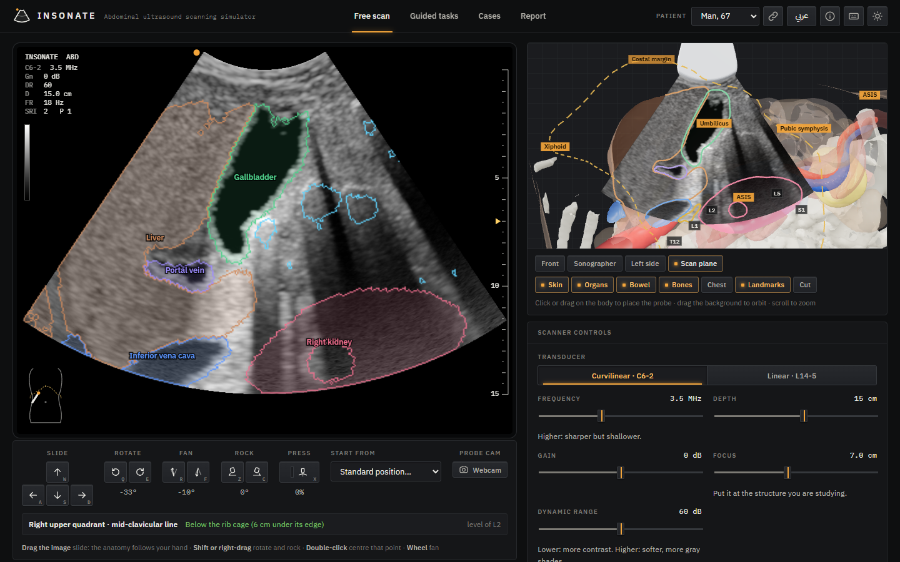
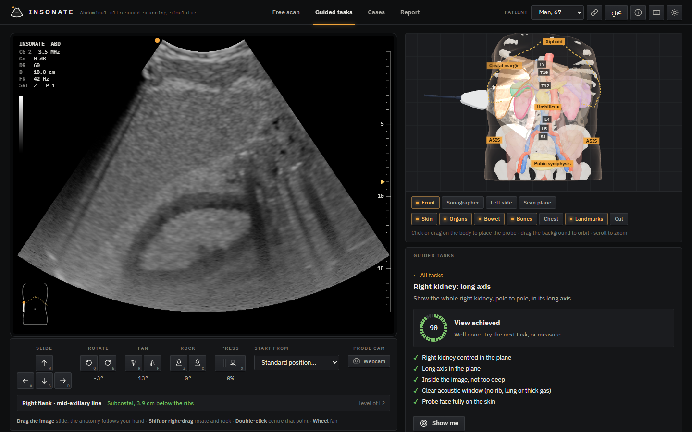
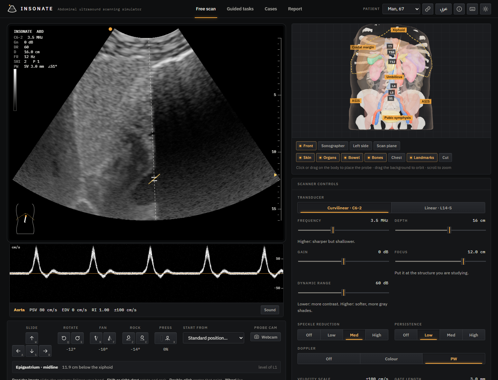
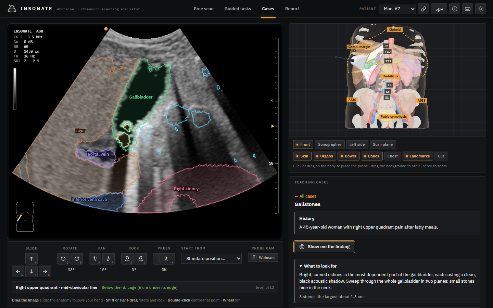
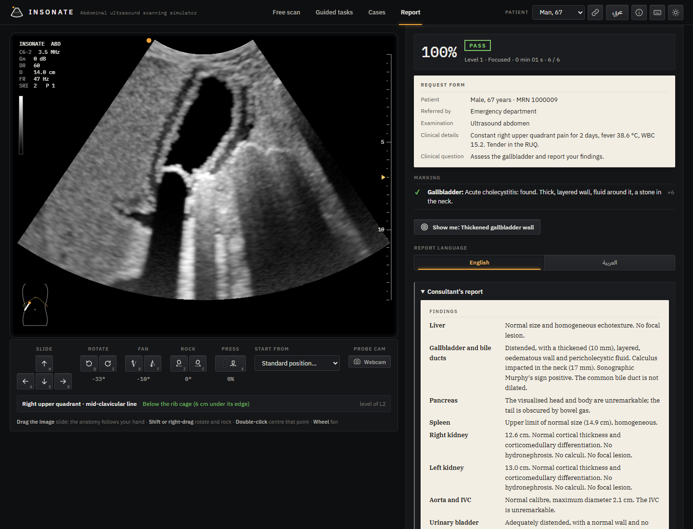
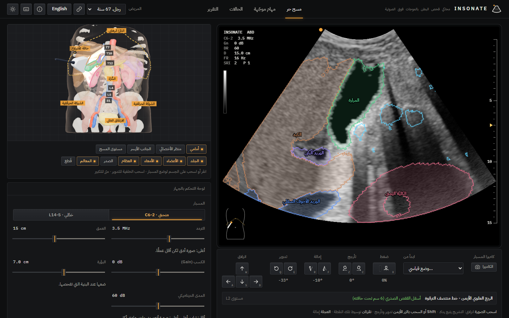
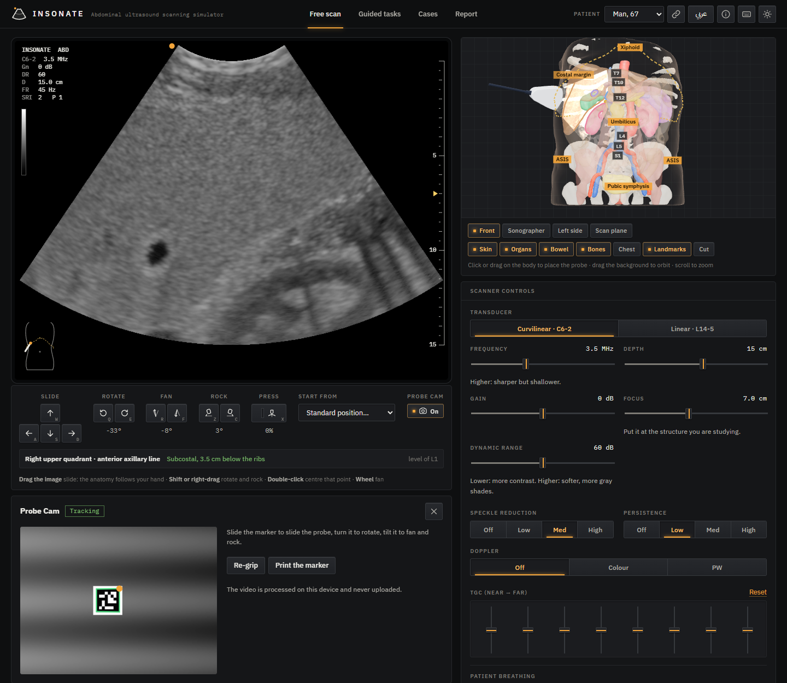
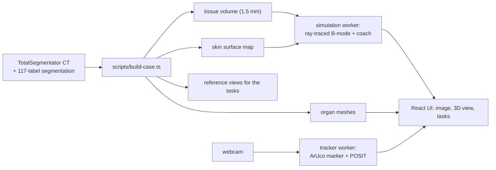

# Insonate

[](https://github.com/YOUR-USERNAME/insonate/actions/workflows/ci.yml)
[](https://github.com/YOUR-USERNAME/insonate/actions/workflows/pages.yml)
[](LICENSE)
[](#what-it-does)

**▶ Try it now: [YOUR-USERNAME.github.io/insonate](https://YOUR-USERNAME.github.io/insonate/)**. Nothing to install; after the first visit it also works offline.

**Learn to scan before you scan a patient.** Insonate is a free abdominal ultrasound simulator that runs in the browser. You hold a virtual probe over real patients' anatomy, built from CT scans, and the image is computed live from the physics of sound in tissue, colour and spectral Doppler included. A coach scores your views and tells you which way to move, and teaching cases add gallstones, free fluid, hydronephrosis, an aortic aneurysm, a liver cyst or a fatty liver to the same patient. In the **reporting exam**, a patient arrives with a request form and findings drawn at random; you scan, measure and write the report organ by organ, and it is marked against what the patient really has, next to a consultant's model report.



## Why

Ultrasound is the most operator-dependent imaging modality: the image only exists while your hand holds the right plane. Students learn it by scanning, but supervised scanning time is scarce, and dedicated simulators are expensive hardware that most students only meet in a skills lab. Insonate is meant to give every student unlimited practice on an ordinary laptop: find the standard views, learn what the knobs do, and see why ribs, gas and fluid change the picture.

## What it does

- **Real anatomy, two patients.** A man of 67 and a woman of 30 from the TotalSegmentator CT dataset (117 segmented structures), converted into acoustic tissue classes at 1.5 mm. Organ positions are checked against the patients' own vertebral levels and landmarks: in the first patient, the kidneys span T11–L3, the gallbladder and pancreas lie at L1–L2, the xiphoid is at T9 and the umbilicus at L3/L4. Checking the cases against their CTs also found something real: **the man of 67 has an infrarenal aortic aneurysm of about 3.7 cm** (and a spleen at the upper limit of normal, 14.9 cm). Scanned as he is, he has it.
- **A physics-based B-mode image**, computed in a Web Worker in about 15–20 ms per frame. Scanlines are traced through the patient. Boundaries reflect, tissues attenuate and scatter, and coherent speckle comes from scatterers fixed in the tissue. Four artefacts emerge from the model rather than being drawn on:
  - clean shadows behind ribs, under a bright bone surface;
  - "dirty" shadows behind bowel gas;
  - enhancement behind the gallbladder and bladder;
  - the mirror image of the liver beyond the diaphragm.

  The image is processed like a modern scanner's: spatial compounding and edge-preserving speckle reduction, frame persistence, and an S-shaped gray map. It is rendered at the screen's own resolution.
- **Real knobology.** C6-2 curvilinear and L14-5 linear probes, frequency, depth, gain, 8-band TGC, focus, dynamic range, speckle reduction, persistence, freeze and calipers. The screen shows the machine's readouts: preset, transducer, gain, depth, frame rate, gray bar, TGC curve, focus and a body marker.
- **Anatomy mode.** Outlines every organ in the image in its own colour, with bone, gas and lung, so you can see what each shadow is. It is the answer key, computed in the same plane as the image.
- **Breathing.** The CT is the "breathe out" state. Ask for a deep breath in and the abdomen's contents slide down from under the ribs: 3 cm just under the diaphragm, less the lower they lie, nothing at the bladder. Fixed structures (body wall, muscles, ribs, spine, aorta, bladder) stay put, and moving organs slide beside them, never into them. Image, coach, anatomy outlines, CT view and 3D view move together. *Show me* asks for the breath each view needs.
- **CT next to the ultrasound.** <kbd>T</kbd> lays the patient's real CT, cut in the same plane, over the image, with a slider from ultrasound to CT. Every organ is where the CT puts it, because the ultrasound is computed from that CT.
- **Where am I?** Under the probe controls, the probe's position in anatomical words: region, surface line, ribs and vertebral level, for example *"Right flank · mid-axillary line · subcostal, 2.4 cm below the ribs · L2"* or *"intercostal, between ribs 10 and 11"*. The body marker on the image is drawn to the patient's own landmarks, with the costal margin.
- **Colour and spectral Doppler.** Blood flows the right way in each vessel, with a laminar profile and a cardiac waveform per vessel type. Colour flow shows red toward the probe and blue away, with the 90° dropout, aliasing, colour gain, wall filter and box. Spectral (PW) Doppler scrolls the triphasic waveform of the aorta or the S, D and a waves of the IVC. It has angle correction with a 60° warning, auto-measured PSV, EDV and RI, and Doppler sound.
- **Teaching cases.** Gallstones, free fluid (FAST), hydronephrosis, an abdominal aortic aneurysm, a simple liver cyst and fatty liver, each with a history, what to look for and *Show me the finding*. Their signs (shadows, enhancement, the black stripe of free fluid) come from the same physics as the normal anatomy. The **mystery patient** hides a random case, perhaps normal, for you to diagnose.
- **Reporting exam.** Three levels:
  1. **Focused.** One clear finding, in the organ the request asks about.
  2. **Full survey.** Every organ and the routine measurements; some patients are normal.
  3. **Consultant.** Subtle findings, grades, tight measurements, incidental findings, and a written impression, read in English or Arabic.

  Each case comes from a clinical scenario: biliary colic, acute cholecystitis, renal colic, trauma (FAST), AAA screening, cancer staging, breathlessness and others. Its findings are made to order, with their size, side, grade and place chosen at random: gallstones, a gallbladder polyp, acute cholecystitis, fatty liver in three grades, liver cyst, haemangioma, metastases, hydronephrosis in three grades, renal stone, renal cyst, AAA, free fluid in three amounts, splenomegaly and pleural effusion. Only plausible findings appear (no aneurysm in a healthy 30-year-old).

  The student writes a structured report on the department's normal template: echotexture, lesions, stones and sizes, Murphy's sign, lengths, hydronephrosis grade, aortic diameter, free fluid and effusions, then an impression. The answer key stays shut during the exam (no outlines, CT or, from level 2, labels). In acute cholecystitis the patient winces when the probe presses over the gallbladder.

  Marking is per finding: found, characterised, measured within tolerance, on the right side. Findings that are not there cost marks, and a normal study must be called normal. The results show each mark with its teaching point, *Show me* for every finding, and a consultant's report with recommendations (AAA surveillance intervals, polyp follow-up), in English or Arabic. A teacher can give a whole class the same case by its **exam code**.
- **Cine loop.** Freeze, then scrub, step (<kbd>←</kbd> <kbd>→</kbd>) or play back the last 10–15 seconds of scanning.
- **3D context view.** An X-ray-like body with organs, bowel, bones and the findings of a teaching case, a realistic probe, and the live scan plane, outlined where it cuts each organ. Landmarks are drawn: the costal margin, the xiphoid, the umbilicus, the iliac spines, the pubic symphysis and the vertebral levels. Hover over an organ to see its name. *Scan plane* turns the camera to face the plane, oriented like the image, and *Cut* opens the body along it.
- **Guided tasks.** Ten standard abdominal views: right kidney (long and short axis), Morison's pouch, gallbladder, aorta, IVC, spleen, left kidney, bladder and pancreas. Each has a live score, a checklist, hints such as *"Slide toward the head"*, and a *Show me* button.
- **Measurement grading.** Measure a kidney, the spleen or the aorta, and Insonate compares your number with the true size in that plane. It also tells you when your plane foreshortens the organ.
- **Probe Cam.** Print a marker, tape it to a box or a phone, and steer the probe by moving it in front of your webcam. Tracking runs on your device.
- **A probe in the hand.** Grab the image and drag it: the anatomy under the pointer follows your hand, as if you slid the probe to bring it there, and dragging up or down sweeps through it. Where sliding cannot bring a deep structure across (under a curving costal margin, a deep point pivots with the probe), the hand heel–toes instead, as a sonographer would. It is a small damped least-squares solve over slide, heel–toe and fan that never leaps ahead of the pointer. <kbd>Shift</kbd>- or right-drag rotates and rocks, the wheel fans, and a double-click brings a structure to the middle of the image. In the 3D view, grab the probe and move it from where it is; the wheel over it rotates it.
- **A face that rests on the skin.** The probe sits on the skin under its whole face, fitted across 2.4 cm, not tipped by every 1.5 mm step of the segmented surface. Sliding no longer makes deep structures jump: the beam turns with the body's real curve, at most 3–5° per millimetre where it used to jolt up to 13°.
- **Graded compression.** Hold <kbd>X</kbd> (or the pad's *Press* key) and the pressure builds up: the face sinks up to 12 mm into the wall and pushes bowel gas aside, opening a window to the aorta or the pancreas. Sonographic Murphy's sign needs it: the patient winces only when the probe presses over an inflamed gallbladder.
- **Keyboard control that works on any layout.** <kbd>W</kbd> <kbd>A</kbd> <kbd>S</kbd> <kbd>D</kbd> slide, <kbd>Q</kbd> <kbd>E</kbd> rotate, <kbd>R</kbd> <kbd>F</kbd> fan, <kbd>Z</kbd> <kbd>C</kbd> rock. Keys are read by position, so they work with an Arabic layout too. A tap nudges by a millimetre or a degree, holding glides smoothly and speeds up after a second, keys combine, and <kbd>Shift</kbd> slows everything down.
- **A console, not a dashboard.** The interface is laid out like a scanner's control panel: graphite panels, engraved labels, keys whose lamp lights amber when engaged, slide pots for the TGC, and a monitor in its bezel. Request forms and reports come on paper, the report set in a serif as it is printed for the patient's file. IBM Plex type (Latin and Arabic) is bundled, so it works offline. Dark and day modes.
- **Shareable links.** One click copies a link to the current patient, mode, task or case, probe position, breath and Doppler. Instructors can send a mystery-patient link that hides the diagnosis.
- **English and Arabic.** The whole interface, the tasks, the cases and the coach are in both languages; Arabic is laid out right to left.
- **Private and offline.** No accounts, no analytics, nothing uploaded. Insonate installs as an app and works without a connection.













## Quick start

The [online version](https://YOUR-USERNAME.github.io/insonate/) needs nothing but a browser. To run it yourself, you need Node.js 20.19 or newer.

```bash
npm install
npm run dev
```

Then open http://localhost:5180. Drag the image itself to move the probe, or use the keyboard: <kbd>W</kbd> <kbd>A</kbd> <kbd>S</kbd> <kbd>D</kbd> slide, <kbd>Q</kbd> <kbd>E</kbd> rotate, <kbd>R</kbd> <kbd>F</kbd> fan, <kbd>Z</kbd> <kbd>C</kbd> rock, hold <kbd>X</kbd> to press, <kbd>N</kbd> toggles Anatomy mode, <kbd>V</kbd> and <kbd>P</kbd> colour and spectral Doppler, <kbd>B</kbd> breathing, and <kbd>?</kbd> lists the rest.

| Command | What it does |
| --- | --- |
| `npm run dev` | Development server on port 5180 |
| `npm run build` | Production build in `apps/web/dist` (set `BASE_PATH=/repo-name/` for GitHub Pages) |
| `npm test` | Unit tests (Vitest) |
| `npm run e2e` | Builds, then runs the browser tests (Playwright) |
| `npm run check` | Lint, typecheck and unit tests |
| `npm run data:fetch` / `npm run data:build` | Download a CT case and rebuild the patient files (see [docs/data.md](docs/data.md)) |
| `npm run previews` | Each task's reference view next to its anatomy, as PNGs in `data/previews` |
| `npx tsx scripts/render-variants.ts` | Each teaching case at a view of its finding, as PNGs in `data/previews/cases` |
| `npx tsx scripts/render-findings.ts [case] [kind…]` | Every kind of exam finding, at the view *Show me* aims at, as PNGs in `data/previews/findings` |
| `npx tsx scripts/audit-anatomy.ts [case]` | Where each organ lies relative to the vertebrae and ribs, from the CT |
| `npm run screenshots` | The README screenshots, from a running dev server |

## How it works



1. **Build time.** [`scripts/build-case.ts`](scripts/build-case.ts) turns one CT and its segmentation into a compact patient of about 3–4 MB. Every voxel becomes one of 56 tissue classes, each with an impedance, an attenuation and an echogenicity. Organ outlines are smoothed, and walls and capsules are added as thin bright shells. The build also writes:
   - a skin map;
   - the patient's landmarks: vertebral levels, the ribs under the skin, the costal margin, xiphoid, umbilicus and pelvis;
   - meshes of the organs, bowel and bones;
   - a reference view for each task, in each breath, chosen by rendering candidate views and keeping the one that shows the organ best.

   → [docs/data.md](docs/data.md)
2. **Probe.** The probe sits on the skin at an angle φ around the body and a height z. Its rotation, fanning and rocking are named the way sonographers name them. → [docs/physics.md](docs/physics.md#probe-model)
3. **Image.** For each of 192 scanlines, the worker marches through the tissue volume. It adds specular echoes at boundaries and coherent scattering in tissue. It applies attenuation, transmission losses, ring-down behind gas and the diaphragm's mirror image. Blood in the colour box records its speed toward the probe from a flow field grown through each vessel. Then the worker convolves with the beam's point-spread function, compounds, log-compresses, adds colour flow and scan-converts into the familiar fan. → [docs/physics.md](docs/physics.md)
4. **Coach.** The score is geometric: is the organ centred in the plane, is the plane aligned with the view, is the organ inside the image, is the beam path clear of bone and gas, and is the face on the skin. Hints come from trying small probe moves and naming the one that helps most. → [docs/coach.md](docs/coach.md)
5. **Probe Cam.** A worker finds an ArUco marker in the webcam frames and estimates its 3D pose. A filtered mapping then turns hand movements into probe movements. → [docs/probe-cam.md](docs/probe-cam.md)

```text
packages/sono-engine   simulation, probe kinematics, coach: plain TypeScript, no DOM, tested in Node
apps/web               React app, workers, 3D view (three.js), Probe Cam
scripts                case building from TotalSegmentator, icons, screenshots, previews
docs                   physics, coach, data, Probe Cam, teaching guide
```

## Documentation

- [How the image is made](docs/physics.md): tissue model, breathing, scanlines, speckle, artefacts, Doppler, the teaching cases and performance
- [The coach](docs/coach.md): scoring, hints, reference views in each breath, the probe-position readout and measurement grading
- [The patient](docs/data.md): from a TotalSegmentator CT to an acoustic model, and how to build another case
- [Probe Cam](docs/probe-cam.md): marker tracking, pose estimation and mapping hand movement to the probe
- [Teaching with Insonate](docs/teaching.md): learning goals, the ten tasks, the teaching cases and mystery patient, the reporting exam and how it marks, Doppler in class and a 60-minute session plan
- [Privacy](docs/privacy.md)

## Testing

- **Unit tests (115, Vitest)** check behaviour, not just code paths. In phantoms:
  - a fluid cyst renders anechoic with posterior enhancement;
  - bone casts a shadow;
  - a gas pocket shows a bright surface over a dirty shadow;
  - the diaphragm mirrors the liver, while bowel gas does not;
  - Doppler finds the flow's direction from the vessel's shape. It shows flow toward the probe in red and away in blue, loses colour at 90° and aliases beyond the scale;
  - a deep breath moves the organs that move with breathing, and nothing else: a kidney slides along a muscle, never into it;
  - each teaching case puts its finding where it belongs: stones on the dependent wall, fluid in Morison's pouch, and an aneurysm about 5 cm across;
  - the exam's findings are made as asked and only where they can be: a polyp on the non-dependent wall, liver lesions inside the liver, more dilatation with each grade of hydronephrosis, a cyst bulging out of the kidney, effusion only in the lung base on the side asked; the same specs always make the same patient;
  - organs are measured the way a sonographer reports them (kidney and spleen lengths, the aorta's widest diameter), and the probe can be aimed at any point without looking through bone or gas;
  - pressing the probe in sinks its face into the wall and pushes shallow bowel gas aside, but not deep gas;
  - the probe face bridges the bumps of a rippled skin: the beam stays within 2° of square, where the old point normal tipped it 18°.

  More unit tests cover the coach, Probe Cam and the app's own logic:
  - The coach scores the textbook plane highly, a plane 15 mm off-centre foreshortens the organ, and the coach's advice comes as data that any language can word.
  - Marker pose is recovered from synthetic camera images.
  - The probe-position words name ribs, intercostal spaces and regions correctly.
  - Shared links round-trip and keep a mystery patient's diagnosis out of sight.
  - Dragging the image keeps the grabbed point under the pointer at any rotation, follows a long drag without the probe ever leaping ahead of it, and heel–toes where sliding round the body only pivots about a deep point, undoing it on the way back.
  - Exam cases are reproducible from their code and only plausible for their patient. Marking gives full marks to a right report, takes marks off for invented findings and the wrong side, notices centimetres typed as millimetres, and reads impressions in English and Arabic with their negations ("no hydronephrosis", "بدون التهاب").
- **Browser tests (15, Playwright)** check these flows:
  - loading the real case, and a guided task completed with *Show me*, which asks for a deep breath and reports *subcostal, mid-axillary line*;
  - the keyboard: a tap nudges, a hold glides, and the W key still works with an Arabic layout;
  - the probe in the hand: dragging the image slides the probe the right way, a double-click centres a point, Shift-drag rotates, and holding X presses in and eases off;
  - Anatomy mode drawing the gallbladder's outline;
  - switching to Arabic (right to left, remembered after a reload);
  - the scan-plane camera, and the data credits;
  - colour Doppler painting the IVC, and the PW spectrum;
  - a teaching case outlining its gallstones, and the mystery patient being graded;
  - a shared link opening the second patient on a case;
  - an exam code opening the same case, a careful report scoring 100 %, the answer key locked until it is handed in, and *Show me* reaching the finding; level 1 asking about one organ, and a missed finding not passing;
  - steering the probe with Probe Cam, using a synthetic webcam video of the marker.

The browser tests need a browser: run `npx playwright install chromium` once, or set `PW_CHANNEL=msedge` (or `chrome`) to use an installed one. `E2E_URL=http://localhost:5180` points them at a running dev server instead of the production build.

## Honest limitations

- There are **two patients**. The teaching cases and exam findings are added to them by a model, not taken from patients with those diseases (except the 67-year-old's aneurysm, which is his own).
- **Doppler** flow is modelled from each vessel's shape, with typical adult speeds and one waveform per vessel type. Vessels CT does not segment (renal, mesenteric) carry no flow.
- Pressing the probe in pushes bowel gas aside and brings the face closer, but organs do not deform: the IVC does not flatten and bowel loops cannot be tested for compressibility.
- The exam's marking is rule-based: it compares structured answers and reads the impression for diagnoses, sides and negations. It does not judge the style of free text.
- Tissue properties are typical textbook values, not these patients'. The kidneys' cortex, pyramids and sinus are modelled from each kidney's outline, because CT does not separate them.
- The image is a teaching approximation. It shows the right artefacts for the right reasons, but it has not been validated against a real scanner.
- Insonate is a teaching tool, **not a medical device**.

## Roadmap

- More patients and body habitus, for example a child-sized or obese abdomen. TotalSegmentator has more than 1,200 CTs, and the build is automatic.
- Organs that give under the probe: the IVC flattening, and compressible versus non-compressible bowel (appendicitis).
- The exam's findings as teaching cases in the Cases tab, and more of them: sludge, cirrhosis, renal masses, appendicitis.
- Doppler of the renal and mesenteric vessels, which would need their segmentation.
- A class dashboard, so an instructor can see students' scores (today each student's results stay in their own browser).

## Credits and licences

- **Anatomy:** cases s0319 and s0139 of the TotalSegmentator v2 dataset (1,228 CTs, 117 structures), [doi:10.5281/zenodo.10047292](https://doi.org/10.5281/zenodo.10047292), CC BY 4.0. Wasserthal J. et al., *TotalSegmentator: Robust Segmentation of 104 Anatomic Structures in CT Images*, Radiology: Artificial Intelligence 2023;5(5):e230024. The files in `apps/web/public/cases` are derived from those cases: resampled, cropped and converted to tissue classes. They remain under CC BY 4.0. The cases were downloaded from the [TotalSegmentator-CT-Lite](https://huggingface.co/datasets/YongchengYAO/TotalSegmentator-CT-Lite) mirror.
- **Marker tracking:** [js-aruco2](https://github.com/damianofalcioni/js-aruco2) by Damiano Falcioni, based on js-aruco by Juan Mellado (MIT). It is vendored as ES modules in `apps/web/src/probecam/vendor`.
- **Methods:** One-Euro filter (Casiez, Roussel and Vogel, CHI 2012); coplanar POSIT (Oberkampf, DeMenthon and Davis, 1996).
- **Libraries:** React, three.js, zustand and Vite (all MIT).

The code is released under the [MIT licence](LICENSE). If you use Insonate in teaching or research, please cite it with [CITATION.cff](CITATION.cff).
